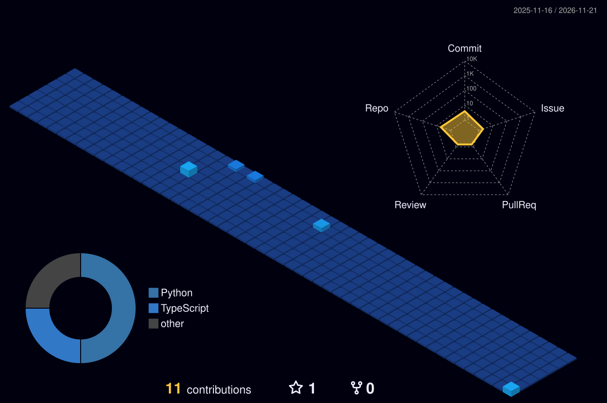

  

  

  

### Ships in the harbour

| Project | What it does | Stack |
| --- | --- | --- |
| [telegram-ai-assistant](https://github.com/ShubJ/telegram-ai-assistant) | Full-stack AI assistant on Telegram, run by a multi-agent engineering system | TypeScript, Telegram |
| [Stock Signal Bot](https://github.com/ShubJ/Stock-Singal-Bot) | Daily BUY/SELL signals for NIFTY 50 stocks with a virtual portfolio and a self-checking analysis loop | TypeScript, Claude, Telegram |
| [AI-News-Bot](https://github.com/ShubJ/AI-News-Bot) | Pulls AI news from several sources and sends a daily digest | Telegram |
| [instagram-bot](https://github.com/ShubJ/instagram-bot) | Instagram automation dashboard with SSR auth and row-level security | Next.js 14, Supabase, Tailwind |
| [Authentication-System](https://github.com/ShubJ/Authentication-System) | JWT auth API with role-based access control | TypeScript, Node.js |
| [Employee-Absence-Management-System](https://github.com/ShubJ/Employee-Absence-Management-System) | Leave management backend API | TypeScript, Node.js |

### My commits, as a city at night

  

  

  

